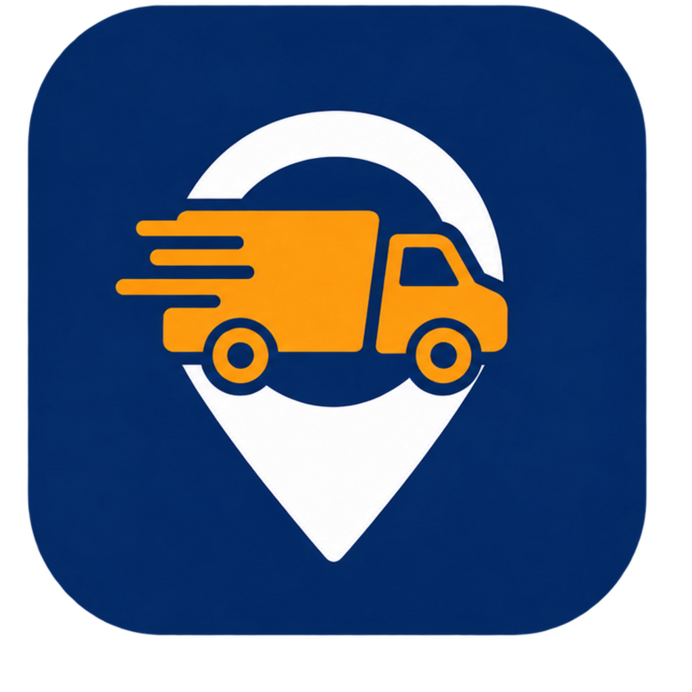

<p align="center">
  
</p>

<h1 align="center">Solus Frete — protótipo funcional</h1>

<p align="center">
  
  
  
  
</p>

Protótipo do aplicativo **Solus Frete**, plataforma de fretes com motoristas parceiros,
transportadoras e entregas agendadas. Construído para o TCC de Sistemas de Informação
e para a disciplina de Gestão de Projetos.

Os requisitos que originaram este protótipo estão no documento
`levantamento-requisitos-solus-frete.md`, resultado da análise funcional de um
aplicativo concorrente consolidado no mercado brasileiro.

## O que está aqui

```
solus-frete/
├── db/                 esquema e dados iniciais do MySQL
│   ├── 01_schema.sql   28 tabelas + 1 view
│   └── 02_seed.sql     catálogo, preços, usuários, pedidos de exemplo e os parceiros
│                       da cotação (47 motoristas autônomos e 11 transportadoras)
├── api/                API REST em Node + Express + MySQL
│   ├── src/server.js   ponto de entrada
│   ├── src/db.js       pool de conexões e helper de transação
│   ├── src/precificacao.js  motor de cálculo do frete
│   ├── src/ofertas.js  monta a cotação com os parceiros (4 motoristas + 6 transportadoras)
│   ├── src/compatibilidade.js  valida a carga e confere se cabe no veículo
│   ├── src/routes/     auth, catalogo, cotacao, enderecos, pedidos, perfil
│   └── test/           testes da regra de compatibilidade (npm test)
└── app/                aplicativo Flutter (cliente + cadastros de parceiro)
    ├── lib/
    │   ├── core/       tema, formatação, veiculos_config.dart (especificações dos
    │   │               veículos), compatibilidade.dart (regra da carga), ajuda_pedido.dart
    │   │               (textos de ajuda) e widgets compartilhados — entre eles
    │   │               widgets/ajuda.dart (botão e bottom sheet de ajuda) e
    │   │               widgets/progresso_pedido.dart (indicador das 4 etapas do pedido)
    │   ├── modelos/    modelos de domínio
    │   ├── dados/      contrato de repositório + implementação mock e implementação API
    │   ├── estado/     Sessao e NovoPedido (Provider/ChangeNotifier)
    │   └── telas/      telas do fluxo — o pedido é feito em 4 etapas: local (mapa,
    │                   telas/novo_pedido_tela.dart) → carga (telas/detalhes_carga.dart)
    │                   → veículo e parceiro (telas/opcoes_frete.dart) → confirmar
    │                   (telas/revisao.dart)
    └── test/           testes da cotação, da compatibilidade, do catálogo de veículos,
                        da tela de login e do fluxo de pedido (flutter test)

docs/                   diagrama ER do banco (PNG, SVG e PDF)
subir.sh                sobe o MySQL e a API e mostra as requisições em tempo real
```

## Como rodar

Clone o repositório antes de tudo:

```bash
git clone https://github.com/Danilo4009/solus-frete-tcc.git
cd solus-frete-tcc
```

### 1. O app sozinho, sem backend

O protótipo já vem com um repositório em memória que reproduz as mesmas regras da
API, inclusive o cálculo de preço. Serve para apresentar o fluxo em sala sem
depender de rede ou banco.

```bash
cd app
flutter pub get
flutter run --dart-define=USAR_API=false
```

Login de demonstração: telefone `11940135904`, senha `solus123` (já preenchidos na tela).

Para rodar os testes do app: `flutter test`.

### 2. Com o MySQL e a API

Cada integrante da equipe roda o próprio MySQL local — sem senha pra compartilhar,
sem expor nada na rede. Todo mundo usa o mesmo `01_schema.sql` e `02_seed.sql`, então
os dados de teste ficam idênticos em qualquer máquina.

**Banco:**

```bash
mysql -u root -p < db/01_schema.sql
mysql -u root -p solus_frete < db/02_seed.sql
```

> Mac com `brew install mysql`: o `root` não tem senha por padrão, então use
> `mysql -u root` (sem `-p`) nos dois comandos.
>
> O `01_schema.sql` apaga e recria o banco `solus_frete`. Se você já tinha dados de
> teste, eles se perdem.

**API:**

```bash
cd api
npm install
cp .env.example .env     # ajuste DB_HOST, DB_USER, DB_PASSWORD
npm start                # http://localhost:3333
curl http://localhost:3333/health
npm test                 # testes da regra de compatibilidade da carga
```

No protótipo, o parceiro escolhido pelo cliente aceita o pedido sozinho depois de alguns
segundos (`ACEITE_AUTOMATICO_SEGUNDOS` no `.env`, padrão 8).

**App** — o endereço da API vai por `--dart-define`, sem editar código:

```bash
flutter run                                              # emulador Android (10.0.2.2:3333)
flutter run --dart-define=API_URL=http://localhost:3333  # iOS simulador, desktop ou web
flutter run --dart-define=API_URL=http://SEU_IP:3333     # celular físico na mesma rede Wi-Fi
```

Se preferir um banco único compartilhado pela equipe (todos veem os mesmos pedidos em
tempo real), qualquer MySQL acessível pela rede serve — só ajustar `DB_HOST` no `.env`
de cada um para apontar pra essa instância em vez do `localhost`.

### 3. No celular

**iPhone** (precisa de um Mac):

1. Instale o Xcode e o CocoaPods (`brew install cocoapods`).
2. Abra `app/ios/Runner.xcworkspace`, vá em Runner → *Signing & Capabilities*, marque
   *Automatically manage signing* e escolha o seu *Personal Team* (Apple ID gratuito).
   **Troque o Bundle Identifier** (`com.danilo4009.solusFrete`) por um só seu; ele
   precisa ser único.
3. No iPhone, ative o **Modo Desenvolvedor** (Ajustes → Privacidade e Segurança), conecte
   o cabo e toque em *Confiar*.
4. Com a API rodando e o iPhone no mesmo Wi-Fi do computador:

   ```bash
   cd app
   flutter run --release --dart-define=API_URL=http://IP_DO_COMPUTADOR:3333
   ```

5. Na primeira vez, confie no seu perfil em Ajustes → Geral → VPN e Gerenciamento de
   Dispositivo.

O IP do Mac sai de `ipconfig getifaddr en0`. Se o macOS perguntar se o `node` pode aceitar
conexões, permita. Com Apple ID gratuito o app expira em 7 dias e precisa ser instalado de
novo. Use `--release` para abrir o app sem o cabo; builds de debug não abrem pela tela
inicial do iOS.

**Android** — o emulador funciona com o padrão (`10.0.2.2`). Num aparelho físico por USB,
a ideia é ativar a depuração USB e usar `adb reverse tcp:3333 tcp:3333` com
`--dart-define=API_URL=http://localhost:3333`. Esse caminho ainda não foi testado num
aparelho físico neste projeto.

> Celular e computador na mesma Wi-Fi às vezes não se enxergam mesmo assim (roteadores
> de operadora e redes mesh costumam isolar os aparelhos uns dos outros por padrão). Se
> o app não conseguir falar com `API_URL=http://IP_DO_COMPUTADOR:3333`, o jeito mais
> rápido de contornar é apontar para uma API hospedada na nuvem — veja a seção
> [Na nuvem](#5-na-nuvem-opcional) a seguir — já que aí o celular funciona em qualquer
> rede, inclusive dados móveis, sem depender da rede local.

### 4. Mapa

O protótipo usa mapa real com tiles do **OpenStreetMap** (`flutter_map` + `latlong2`),
sem chave de API nem cartão de crédito. O widget `MapaSimulado`
(`app/lib/core/widgets/comuns.dart`) mostra os pontos do roteiro com marcadores (coleta
em azul, entregas em laranja), liga-os com uma linha e, na tela de acompanhamento, anima
a posição do veículo ao longo da rota. É usado nas telas de novo pedido, detalhes do
endereço, veículo e parceiro, e acompanhamento.

Por ser o serviço público de tiles do OpenStreetMap, vale a [política de uso
aceitável](https://operations.osmfoundation.org/policies/tiles/) deles — adequada para
desenvolvimento e apresentação, mas não para um volume grande de usuários em produção.
Para isso, o caminho é trocar a `urlTemplate` do `TileLayer` por um provedor de tiles
próprio ou pago (Mapbox, MapTiler, Stadia Maps etc.).

A busca de endereço ainda usa a lista de endereços cadastrados (favoritos, recentes e
busca textual simples) e não faz geocodificação real; esse é um próximo passo natural,
usando por exemplo o [Nominatim](https://nominatim.org/) do próprio OpenStreetMap.

### 5. Na nuvem (opcional)

Para testar no celular sem depender da mesma rede do computador (inclusive em dados
móveis), dá pra hospedar a API e o MySQL gratuitamente no [Railway](https://railway.com):

```bash
brew install railway        # ou: npm i -g @railway/cli
railway login
railway init --name solus-frete
railway add --database mysql

cd api
railway add --service api
railway variable set DB_HOST='${{MySQL.MYSQLHOST}}' --service api --skip-deploys
railway variable set DB_PORT='${{MySQL.MYSQLPORT}}' --service api --skip-deploys
railway variable set DB_USER='${{MySQL.MYSQLUSER}}' --service api --skip-deploys
railway variable set DB_PASSWORD='${{MySQL.MYSQLPASSWORD}}' --service api --skip-deploys
railway variable set DB_NAME='${{MySQL.MYSQLDATABASE}}' --service api --skip-deploys
railway variable set JWT_SECRET="$(openssl rand -hex 32)" --service api --skip-deploys
railway up --service api -y            # faz o deploy a partir da pasta api/
railway domain --service api            # gera a URL pública (https://...up.railway.app)
```

O `01_schema.sql` cria o próprio banco `solus_frete` (não usa o banco `railway` padrão
do plugin), então depois de criar o serviço MySQL é preciso **trocar o `DB_NAME` para
`solus_frete`** e carregar o schema e o seed nele — abra uma porta pública temporária
para isso (`railway tcp-proxy create --port 3306 --service MySQL`), rode os dois
`mysql ... < db/0X_*.sql` apontando pro endereço que o comando devolver, e depois feche
a porta (`railway tcp-proxy delete`).

Com a URL gerada, aponte o app pra ela: `flutter run --release
--dart-define=API_URL=https://SUA-URL.up.railway.app --dart-define=USAR_API=true`.

> O plano usado por padrão no Railway é um **trial gratuito por tempo limitado** — serve
> bem para testes e apresentação, mas não é hospedagem permanente. Para manter a API no
> ar indefinidamente, é preciso assinar um plano pago (o mais simples gira em torno de
> alguns dólares por mês).

## Fluxos implementados

**Cliente**: login e cadastro; busca de endereço com favoritos, recentes e complemento
com contato no local; roteiro com múltiplas paradas e inversão de sentido; retirada
imediata ou agendada. O pedido é feito em 4 etapas com indicador de progresso (local →
carga → veículo → confirmar): detalhes da carga (peso total, dimensões do maior volume,
quantidade de volumes, tipo e observações) são informados antes de escolher o veículo,
com validação dos campos; catálogo de veículos com ficha técnica (dimensões, capacidade e
serviços disponíveis); veículos que não comportam a carga aparecem desabilitados com o
motivo, e o veículo já escolhido é desmarcado se uma alteração na carga o tornar
incompatível; o menor veículo que ainda comporta a carga é destacado como recomendado
(borda e selo animados); serviços adicionais por categoria; contratação por período (4h,
6h, 8h); botão de ajuda em destaque e ícones "i" por seção com dicas para quem nunca usou
a plataforma; cotação com até 10 parceiros da região (4 motoristas autônomos e 6
transportadoras), com filtro por tipo, ordenação por preço, prazo e avaliação e
detalhamento do preço; escolha do parceiro, que aceita ou recusa o pedido (simulado no
protótipo) e, se recusar, o cliente volta à lista para escolher outro; cupom de desconto;
motoristas favoritos com destaque na lista; exigência de comprovante de entrega; pagamento
por carteira, Pix, cartão ou dinheiro com escolha do pagador (frete a pagar); revisão e
confirmação; acompanhamento com mapa real (OpenStreetMap), linha do tempo e dados do
parceiro; simulação da máquina de estados; cancelamento com regra de taxa por etapa;
avaliação com opção de favoritar; histórico com abas, busca e nome do parceiro; motoristas
favoritos com convite por telefone; carteira com saldo, recarga e extrato; caixa de
entrada; perfil e preferências.

**Parceiros**: cadastro de motorista em três passos (dados pessoais, habilitação com
validade e anexo, veículo com categoria e documento) e cadastro de transportadora em
três passos (empresa com CNPJ e registro ANTT, responsável legal, frota inicial). Ambos
terminam em homologação pela operação, conforme o requisito RF06.

## Cobertura do backlog

Situação de cada história de usuário do backlog no protótipo:

| História | Título | Situação | Observação |
|---|---|---|---|
| US01 | Login | Parcial | Entra por telefone e senha. Faltam login por e-mail, recuperação de senha, bloqueio após 3 tentativas e o aviso de LGPD |
| US02 | Cadastro de contratante | Parcial | Faltam CPF com validação, token por SMS ou e-mail e consentimento LGPD |
| US03 | Cadastro de transportadora | Parcial | Faltam validação do CNPJ, token e consentimento LGPD. Os anexos são simulados |
| US04 | Cadastro de motorista parceiro | Parcial | Faltam token, consentimento LGPD e o vínculo com uma transportadora. Os anexos são simulados |
| US05 | Solicitação do frete | Implementada | Imediato ou agendado, roteiro, carga, estimativa, revisão e status |
| US06 | Dados da carga | Parcial | Peso, dimensões do maior volume, volumes, tipo (inclui frágil, refrigerada e perigosa), observações e validação dos campos. Faltam o nível de fragilidade e o destaque da carga perigosa para o parceiro |
| US07 | Origem e destino | Parcial | Busca de endereço e distância; a coleta define o raio dos parceiros; mapa real (OpenStreetMap). Faltam validação por CEP, geocodificação de endereço digitado livremente e escolha arrastando o pino no mapa |
| US08 | Consulta e comparação de cotações | Implementada | 10 parceiros, filtro e ordenação; se o parceiro recusa, volta à lista |
| US09 | Consulta de avaliação | Parcial | Nota, total de fretes e "Sem avaliações ainda". Faltam os comentários e o perfil do parceiro |
| US10 | Comunicação (chat) | Não implementada | |
| US11 | Acompanhamento do frete | Parcial | Status e linha do tempo simulados; mapa real (OpenStreetMap) com a posição do veículo interpolada ao longo da rota, mas sem localização em tempo real de verdade |
| US12 | Demanda de fretes (transportadora) | Não implementada | Lado do parceiro fora do escopo do protótipo |
| US13 | Gestão de frota e motoristas | Não implementada | A frota vem só do cadastro e do seed |
| US14 | Ganhos da transportadora | Não implementada | |
| US15 | Demanda de fretes (motorista) | Não implementada | Lado do parceiro fora do escopo do protótipo |
| US16 | Ganhos do motorista | Não implementada | |

Fora do escopo (Won't): IA no canal de chat e nas rotas.

## Veículos

O catálogo tem 9 categorias. Moto e Carro ficam para uma possível expansão do negócio,
embora as capacidades pequenas deixem poucas cargas caberem neles. As especificações ficam em
`app/lib/core/veiculos_config.dart` (usadas pelo app no modo sem backend e pelos testes) e,
com a API, na tabela `categoria_veiculo` do `db/02_seed.sql`; o teste
`test/veiculos_config_test.dart` confere que os dois continuam iguais.

| Veículo | Capacidade | Baú (C × L × A, m) | Volume | Refrigerada | Perigosa |
|---|---|---|---|---|---|
| Moto | 20 kg | 0,40 × 0,35 × 0,30 | 0,04 m³ | não | não |
| Carro | 200 kg | 1,20 × 0,90 × 0,70 | 0,76 m³ | não | não |
| Utilitário | 650 kg | 1,90 × 1,30 × 1,20 | 2,96 m³ | não | não |
| Van | 1.500 kg | 3,00 × 1,70 × 1,80 | 9,18 m³ | não | não |
| VUC | 3.000 kg | 4,50 × 2,10 × 2,20 | 20,79 m³ | sim | não |
| Caminhão 3/4 | 4.000 kg | 5,50 × 2,30 × 2,40 | 30,36 m³ | sim | não |
| Caminhão toco | 6.000 kg | 7,00 × 2,40 × 2,60 | 43,68 m³ | sim | sim |
| Caminhão truck | 12.000 kg | 8,50 × 2,40 × 2,70 | 55,08 m³ | sim | sim |
| Carreta | 25.000 kg | 14,00 × 2,50 × 2,80 | 98,00 m³ | sim | sim |

Para ajustar um veículo ou adicionar outro: edite `veiculos_config.dart`, o `INSERT` de
`categoria_veiculo` e o preço (`tabela_preco` no seed e `_tarifas` no `RepositorioMock`).
Se o código for novo, acrescente também os modelos dos parceiros (`tmp_modelo` no seed e
`_modelos` no mock). O seed falha de propósito se uma categoria ficar sem preço, em vez de
herdar o de outra. Depois recarregue o banco (`01_schema.sql` e `02_seed.sql`).

## Regras de negócio no código

| Regra | Onde está |
|---|---|
| Pedido só confirma com roteiro, carga preenchida, veículo e forma de pagamento | `NovoPedido.pendenciasParaConfirmar` e `routes/pedidos.js` |
| Peso, dimensões e tipo da carga precisam ser válidos (maiores que zero) | `validarCarga` em `core/compatibilidade.dart` e `api/src/compatibilidade.js` (HTTP 400 na API) |
| A carga precisa caber no veículo: peso total ≤ capacidade, maior volume dentro do baú (podendo ser girado) e tipo aceito (refrigerada e perigosa só em veículo habilitado) | `verificarCompatibilidade` em `core/compatibilidade.dart` e `api/src/compatibilidade.js` (HTTP 422 na API) |
| Veículo incompatível fica desabilitado com o motivo; se a carga mudar, o veículo escolhido é desmarcado | `NovoPedido.definirCarga` e `telas/opcoes_frete.dart` |
| Agendamento precisa ser no futuro | `NovoPedido` e `routes/pedidos.js` |
| Aceite de itens proibidos obrigatório | `TelaRevisao` e `routes/pedidos.js` |
| A cotação mostra até 10 parceiros: 4 motoristas autônomos e 6 transportadoras (se faltar de um tipo, completa com o outro) | `api/src/ofertas.js` (`selecionar`) e `RepositorioMock._montarCotacao` |
| Só entra na cotação parceiro aprovado, disponível, com veículo da categoria e coleta dentro do raio de atuação | `api/src/ofertas.js` (`montarCotacao`) |
| Motorista autônomo usa a tabela de preço da plataforma; transportadora tem preço próprio | `api/src/ofertas.js` e tabela `transportadora_preco` |
| Favoritos aparecem primeiro entre os motoristas; depois quem tem nota e o mais próximo da coleta | `api/src/ofertas.js` (`ordenar`) |
| O pedido vai só ao parceiro escolhido; se ele recusar, o pedido volta a `cotado` e o parceiro sai da lista | `POST /pedidos/:id/recusar-parceiro`, `GET /pedidos/:id/cotacao`, `POST /pedidos/:id/parceiro` |
| O preço do parceiro escolhido é sempre recalculado no servidor | `routes/pedidos.js` (`POST /pedidos`) |
| Cancelamento sem taxa antes da alocação, 15% depois, bloqueado após a coleta | `POST /pedidos/:id/cancelar` |
| Comissão da plataforma sobre o valor do frete | `precificacao.repasseParceiro` |
| Cupom só vale acima do valor mínimo do pedido | `precificacao.aplicarCupom` |

## Calibragem do preço

O motor usa `tarifa_base + valor_por_km × km + valor_por_parada × paradas_extras`,
respeitando o valor mínimo da categoria.

- **Motoristas autônomos** usam a linha `padrão` da `tabela_preco` da plataforma.
- **Transportadoras** têm preço próprio em `transportadora_preco`. No seed, é a tabela da
  plataforma multiplicada por um fator entre 0,89 e 1,15 por empresa.
- Os níveis expresso e econômico continuam na `tabela_preco`, mas a cotação não os usa
  mais: quem diferencia as opções agora é o parceiro (preço, prazo e avaliação).
- O prazo estimado soma o deslocamento do parceiro até a coleta, o trajeto e 15 minutos
  de manuseio, a uma média de 30 km/h.

A calibragem original foi feita com a categoria Carreto, que saiu do catálogo: na rota
Osasco → Avenida Paulista o preço `padrão` ficou em R$ 155,64 contra R$ 152,68 do
concorrente, ou seja, a estrutura de preço reproduz a ordem de grandeza do mercado. Os
preços das categorias novas (VUC, caminhão truck e carreta) seguem a mesma escala, mas
são valores de protótipo e não foram comparados com o mercado.

Isso é calibragem de protótipo, não precificação de negócio. A tabela definitiva precisa
partir de custo operacional próprio e da comissão que vocês decidirem praticar; os dois
pontos continuam abertos no documento de requisitos.

## Endpoints da API

```
GET    /health
POST   /auth/login
POST   /auth/registro/cliente
POST   /auth/registro/motorista
POST   /auth/registro/transportadora
GET    /catalogo/veiculos?cidade=
GET    /catalogo/cidades
GET    /catalogo/servicos
POST   /cotacao
GET    /enderecos
GET    /enderecos/busca?q=
POST   /enderecos
PATCH  /enderecos/:id/favorito
DELETE /enderecos/:id
GET    /pedidos?situacao=&q=
GET    /pedidos/:id
POST   /pedidos
GET    /pedidos/:id/cotacao
POST   /pedidos/:id/recusar-parceiro
POST   /pedidos/:id/parceiro
POST   /pedidos/:id/avancar
POST   /pedidos/:id/cancelar
POST   /pedidos/:id/avaliar
GET    /perfil
PUT    /perfil
GET    /perfil/carteira
POST   /perfil/carteira/recarga
GET    /perfil/favoritos
POST   /perfil/favoritos/convite
DELETE /perfil/favoritos/:motoristaId
GET    /perfil/notificacoes
PATCH  /perfil/notificacoes/:id/lida
```

Rotas sob `/enderecos`, `/pedidos` e `/perfil` exigem `Authorization: Bearer <token>`,
obtido no login. Senha de todos os usuários do seed: `solus123`.

**Cotação e escolha do parceiro**

`POST /cotacao` recebe `{ categoriaId, paradas, servicos, horas, cupom }` e devolve as
`ofertas` (até 10). Cada oferta traz o parceiro, a nota, o prazo e o preço:

```json
{
  "chave": "transportadora-7",
  "parceiroTipo": "transportadora",
  "parceiroId": 7,
  "nome": "Barueri Log",
  "nota": 4.5,
  "totalFretes": 730,
  "favorito": false,
  "veiculo": "Mercedes Sprinter Chassi",
  "distanciaColetaKm": 12.6,
  "chegadaColetaMin": 25,
  "prazoEntregaMin": 80,
  "valorFrete": 138.56,
  "valorAdicionais": 0,
  "desconto": 0,
  "total": 138.56
}
```

`POST /pedidos` recebe a carga em `carga`: `tipoCarga` (`caixas_pacotes`, `paletizada`,
`granel`, `fragil`, `refrigerada` ou `perigosa`), `pesoKg`, `comprimentoCm`, `larguraCm`,
`alturaCm` (do maior volume), `volumes` e, opcionais, `naoEmpilhar` e `observacoes`. Campo
ausente ou menor ou igual a zero devolve 400; carga que não cabe no veículo devolve 422 com o
`motivo` (por exemplo, "Excede a capacidade de 1.500 kg"). Além da carga, recebe `parceiroTipo` (`motorista` ou `transportadora`) e `parceiroId` no
lugar do antigo nível de serviço. O pedido nasce em `aguardando_alocacao` e segue só para
o parceiro escolhido. `POST /pedidos/:id/recusar-parceiro` existe apenas no protótipo, para
simular a recusa; o pedido volta a `cotado`, `GET /pedidos/:id/cotacao` traz as opções
sem o parceiro que recusou e `POST /pedidos/:id/parceiro` escolhe outro.

## Como contribuir

1. Crie uma branch a partir da `main`: `git checkout -b minha-feature`.
2. Faça as alterações e commit.
3. Abra um Pull Request pra `main` — quem revisar confere se a API e o app continuam
   rodando antes de aprovar.

Se você não tem permissão de push direto neste repositório, faça um fork e abra o PR
a partir dele.

## O que ficou fora de propósito

Cadastro de cartão de crédito (fora do protótipo por segurança), upload real de
documentos (o anexo é simulado), app do motorista e painel da transportadora como
aplicativos próprios (por isso o aceite e a recusa do parceiro são simulados),
recomendação de veículo por foto, programa de fidelidade e
indicação de amigos. Tudo isso está mapeado nas fases 2 e 3 do backlog no documento de
requisitos.
